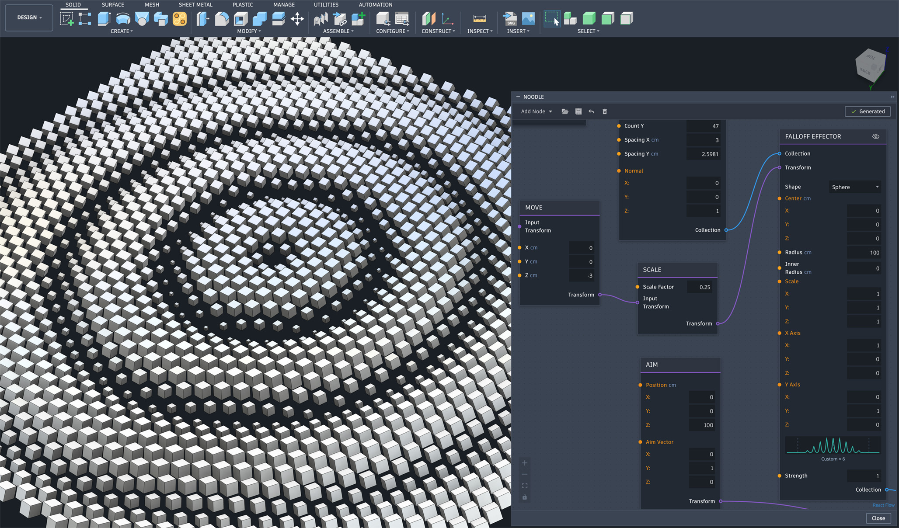

# Noodle

Noodle is a node-based algorithmic modeling add-in for Autodesk Fusion. You build a graph of nodes in a palette inside Fusion, press **Generate**, and Noodle turns the graph into solid bodies in your design. If you have used Grasshopper or a similar visual programming tool, the workflow will feel familiar.



With the current set of 37 nodes you can:

- **Create source geometry**: Box, Sphere, Cylinder, and Polygon primitives, or bring in an existing body with Body Instance.
- **Array instances**: in 2D grid, staggered, and hexagonal layouts on a plane; across a selected face (UV, grid, hex, and spiral layouts); or along a selected curve or edge.
- **Work with collections**: turn geometry into a collection of instances (Atomizer), turn instances back into bodies (Materializer), start from a single empty instance (Null to Collection), or split a grid into U and V strands (UV Separator).
- **Make curves**: fit splines through instance positions (Interpolize).
- **Apply effectors**: transform a whole collection at once (Uniform Effector), or with strength that falls off from a sphere, box or line (Falloff Effector), shaped in a curve editor. Preview an effector's reach as colored dots in the viewport before you generate.
- **Create features**: run pipes along curves (Pipe).
- **Do math**: Number, Add, Multiply, Absolute, Vector3, and 3D Point (from a selected point).
- **Vary effector strength per instance with modifiers**: Gradient, Falloff, Wave, Checkerboard, Random, and Noise.
- **Build transforms**: Move, Rotate, Scale, Scale Non-Uniform, and Aim, plus Apply Transform for single bodies.

For every node and port, see the [node reference](docs/nodes.md).

## Status

Noodle is a **proof of concept** at a pre-alpha stage. Expect bugs and breaking changes, including changes that may stop saved graphs from loading. It is not available on the Autodesk App Store. Don't rely on it for production work.

## Requirements

- Autodesk Fusion on macOS. Noodle is developed and tested on macOS only. It should run on Windows, but **Windows is untested**, so expect rough edges there and please open an issue if you hit one.
- No extra Python packages. Noodle uses only the Python that ships with Fusion.
- The palette UI is prebuilt and included in the repository. You don't need Node.js unless you plan to change the UI.

## Install

Fusion requires the add-in folder name to match `Noodle.py` and `Noodle.manifest`, so **the folder must be named `Noodle`**.

1. Open a terminal in your Fusion AddIns folder:
   - macOS: `~/Library/Application Support/Autodesk/Autodesk Fusion 360/API/AddIns/`
   - Windows: `%APPDATA%\Autodesk\Autodesk Fusion 360\API\AddIns\`
2. Clone the repository into a folder named `Noodle`:

   ```sh
   git clone https://github.com/jmaruska/Fusion-Noodle.git Noodle
   ```

   If you download a ZIP instead, it extracts as `Fusion-Noodle-main`. Rename that folder to `Noodle` and move it into the AddIns folder.
3. In Fusion, open **Utilities → Add-Ins** (Shift+S) and select the **Add-Ins** tab.
4. Select **Noodle** and click **Run**. To start Noodle every time Fusion launches, also check **Run on Startup**.

When Noodle runs, it adds a **Noodle** button to the **Design** workspace, on the **Solid** tab in the **Create** panel, next to Pattern. The button is also promoted to the toolbar. Click it to open the Noodle palette, which docks on the right side of the window.

## Quick start

1. Open or create a design, then click **Noodle** in the Solid → Create panel.
2. Click **Add Node** and add **Sources → Box**, then **Array → Array 2D Grid**. Noodle adds an Atomizer before the array and a Materializer after it, already connected.
3. Connect the Box to the Atomizer by dragging from the Box's **Geometry** output to the Atomizer's **Geometry** input.
4. Click **Generate**. A 3 × 3 grid of boxes appears in a Base Feature named `Noodle_Geometry`.

For the full walkthrough, see [Getting started](docs/getting-started.md).

## Documentation

- [Getting started](docs/getting-started.md): using the palette, plus a complete example graph.
- [Examples](examples/): graph files you can open from the palette.
- [Node reference](docs/nodes.md): every node, port, type, and default. This file is generated from the code.
- [Developer docs](docs/dev/): architecture, adding a node, and building the UI.

## Known limitations

- **Windows is untested.** Everything here was built and checked on macOS.
- **Geometry isn't parametric.** Noodle writes bodies into one Base Feature named `Noodle_Geometry`. Each **Generate** deletes that Base Feature and creates it again. Fusion features that reference Noodle bodies will break when you regenerate.
- **All lengths are in centimeters**, which is Fusion's internal unit, whatever your document units are. Angles are in degrees. Inputs that take a length or an angle show `cm` or `°` after their label. Numbers are not converted.
- **Geometry only changes when you click Generate.** Your graph edits are remembered and saved with the document, but the design keeps the last generated geometry until you generate again. **Clear** (the trash icon) deletes the Base Feature and both saved versions of the graph.
- **One graph per document.** If a document has more than one saved graph, only the first one loads.
- **Arrays don't stack.** An array places copies of its source geometry. It keeps the scale of incoming instances but not their position or rotation, so feeding one array into another piles copies on the same points. Put effectors after the array, not before it.
- **UV Separator needs a grid.** It works only on the output of Array 2D Grid or Surface Grid Array.
- **Instance limits.** Grid arrays allow up to 100 per axis, Array on Path up to 10,000 instances, and a Materializer up to 10,000 bodies.
- **No mirroring.** Scale factors must be greater than 0.
- **Modifiers only drive effectors.** Random, Noise, and the other modifiers connect to an effector's Strength or to another modifier, not to other number inputs.
- **Generation is synchronous.** Fusion is busy while the graph runs. A progress dialog with a Cancel button appears when a Generate takes more than about a second. Cancelling leaves the geometry incomplete, so Generate again to rebuild it.

## License

MIT. See [LICENSE](LICENSE).

## Packaging a Fusion add-in release

From the repository root, check out the release commit and run this command with Git (Bash or Git Bash). It packages the tracked runtime files under the folder name Fusion expects.

```sh
git archive --format=zip --prefix=Noodle/ --output=Noodle-universal.zip HEAD -- Noodle.manifest Noodle.py __init__.py config.py backend resources examples ui/index.html ui/dist ui/icons ui/styles LICENSE
```

Upload `Noodle-universal.zip` as an asset of a stable GitHub Release. Use a numeric tag such as `v0.1.1` matching the version in `Noodle.manifest`.
